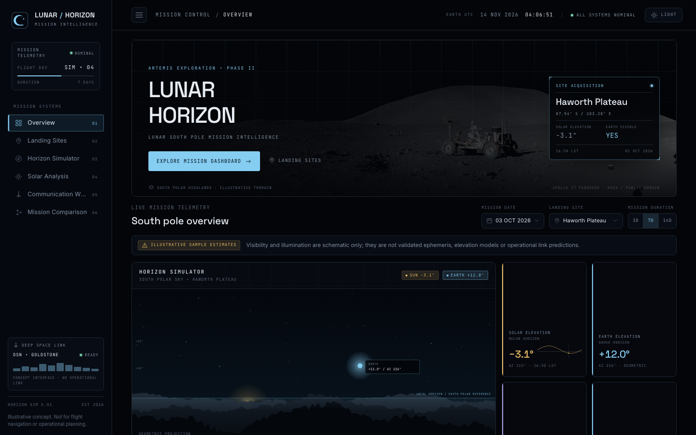

# Celestial — Lunar Horizon

> **Lunar South Pole Mission Intelligence Platform**  
> Explore candidate landing sites, solar illumination regimes, Earth visibility windows, and mission trade studies.



## Overview

Celestial (Lunar Horizon) is an interactive mission intelligence and trajectory analysis workstation tailored for lunar south pole exploration. It models terrain topography, orbital illumination dynamics, and direct-to-Earth (DTE) communications to support mission planning, landing site evaluation, and science operations.

## Key Features

- **Mission Overview Dashboard**: High-level telemetry, mission objectives, site readiness, and environmental profiles.
- **Candidate Landing Sites**: Detailed breakdowns of candidate polar landing sites (e.g., Shackleton Connecting Ridge, Malapert Mountain, Faustini Rim, Haworth) with slope, roughness, and illumination metrics.
- **Horizon & Terrain Simulator**: Real-time 360° terrain elevation profile modeling, solar and Earth vector projections against local topographical obstacles.
- **Solar Illumination Analysis**: Long-term lighting cycle projections, peak sunlight and eclipse duration forecasts, and power availability simulations.
- **Communication Windows**: Line-of-sight tracking for Direct-to-Earth communication links, occultation windows, and relay requirements.
- **Mission Trade Studies & Comparison**: Side-by-side multi-parameter comparison across landing targets to determine optimal landing windows and scientific return.

## Tech Stack

- **Framework**: [React 19](https://react.dev/)
- **Language**: [TypeScript](https://www.typescriptlang.org/)
- **Build Tool**: [Vite](https://vite.dev/)
- **Visualizations**: Interactive HTML5 Canvas & SVG renderings
- **Styling**: Modern CSS design system with custom space-mission tokens and dark mode support

## Getting Started

### Prerequisites

- Node.js (v18 or higher recommended)
- npm or yarn / pnpm

### Installation

```bash
git clone https://github.com/SarthakPatil18/celestial.git
cd celestial
npm install
```

### Development Server

Start the local development server:

```bash
npm run dev
```

### Production Build

Build the project for production:

```bash
npm run build
```

Preview the production build:

```bash
npm run preview
```

## License

MIT
